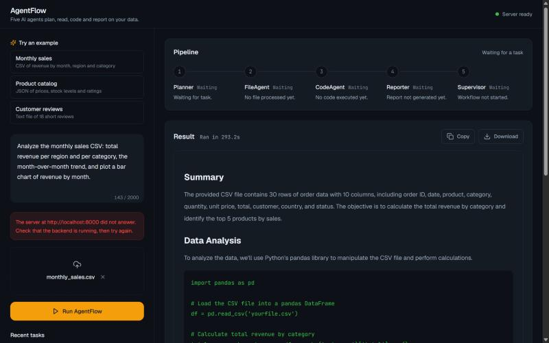
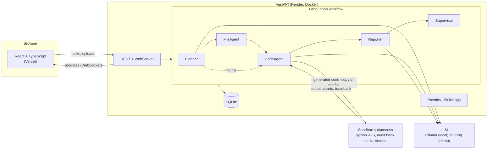

# AgentFlow: multi-agent data analysis

> Describe a task and add a CSV, JSON or TXT file. Five AI agents plan it, read the
> data, write and run Python in a sandbox, fix their own code when it fails, and
> hand you a Markdown report with charts.

**Live demo: [agentflow-alpha-azure.vercel.app](https://agentflow-alpha-azure.vercel.app)**. Pick one
of the three examples; no dataset needed.

[](https://github.com/Gninho-silue/agentflow/actions/workflows/ci.yml)
[](https://github.com/Gninho-silue/agentflow/actions/workflows/deploy.yml)




It runs **fully locally with Ollama** (no API key, no cost). The hosted demo uses
**Groq's free tier**, because a free cloud instance has no GPU.

---

## What it does

| Agent | Role |
| --- | --- |
| **Planner** | Splits the task into subtasks and chooses the agents it needs |
| **FileAgent** | Reads the uploaded CSV, JSON or TXT file into rows and a summary (skipped when there is no file) |
| **CodeAgent** | Writes pandas / matplotlib code and runs it in an isolated sandbox; on an error it sends the code and traceback back to the LLM, up to 3 attempts |
| **Reporter** | Writes the Markdown report from the computed facts only; a deterministic checker verifies its numbers and rankings, asks for one rewrite if needed, then flags what is still wrong |
| **Supervisor** | Checks the workflow state and ends the run cleanly, including on errors |

The interface streams each agent's state over a WebSocket and shows the duration
per agent, the generated code, every self-correction attempt and the charts. Reports
can be copied or downloaded as Markdown.

### Reports are fact-checked

LLMs can contradict their own tables ("Home has the highest average price" next to a
table where Electronics is higher). So the report is checked against what the code
actually computed:

1. The sandbox extracts the **computed facts** from the pandas objects the code printed
   or kept (per-category values), with the `max` / `min` of each indicator
   (`backend/facts.py`).
2. The Reporter gets them as JSON, as its only source of numbers and rankings
   (temperature 0).
3. A **deterministic checker** verifies that every number in the report exists in the
   facts, that every superlative (highest, lowest, most, least, le plus élevé...) names
   the real max / min of its indicator, and that no indicator gets contradictory claims.
4. On a failure the Reporter rewrites once with the list of errors; if problems remain,
   a visible **Fact check** section lists them at the end of the report.

## Architecture



## Run it locally (Ollama, no API key)

Prerequisites: [Ollama](https://ollama.com/download), Python 3.11 or 3.12, Node.js 20.

```bash
ollama pull llama3.2:1b

git clone https://github.com/Gninho-silue/agentflow.git
cd agentflow

# Backend, from the repository root
python -m venv .venv && source .venv/bin/activate   # Windows: .venv\Scripts\activate
pip install -r backend/requirements.txt
uvicorn backend.main:app --reload --port 8000

# Frontend, in a second terminal
cd frontend
npm install
npm run dev
```

Open [http://localhost:5173](http://localhost:5173). Or run both with Docker
(non-root image, read-only root filesystem): `docker compose up --build`.

On CPU the default `llama3.2:1b` takes a few minutes per task. A larger model such
as `llama3.2:3b` writes better code but is slower; with Groq a task takes seconds.

### Configuration

All agents get their model from one factory (`backend/llm.py`):

| Variable | Default | Meaning |
| --- | --- | --- |
| `LLM_PROVIDER` | `ollama` | `ollama` (fully local) or `groq` (hosted API) |
| `LLM_MODEL` | `llama3.2:1b` (ollama) / `openai/gpt-oss-120b` (groq) | Model for the chosen provider |
| `OLLAMA_HOST` | `http://localhost:11434` | Ollama server URL |
| `GROQ_API_KEY` | none | Required with `groq`; read from the environment only, never committed |

Before each task the backend checks that the model answers (Ollama reachable, or
Groq key valid and model still offered) and fails fast with an actionable message
otherwise. Other settings are listed in [`.env.example`](.env.example).

## Security model

The CodeAgent runs Python written by an LLM, so that code is treated as untrusted.
It never runs inside the API server process:

| Layer | What it does |
| --- | --- |
| **Separate process** | Each run starts a fresh `python -I -S -B` process with an **empty environment** (no `GROQ_API_KEY`, no server secrets). |
| **Throw-away working dir** | The `cwd` is a new temporary directory holding only a **copy** of the uploaded file. Charts are collected from it, then it is deleted. |
| **Audit hook** (`sys.addaudithook`) | Installed after the trusted imports. Refuses reading files outside the working dir and the Python installation, writing outside the working dir, sockets and HTTP, `subprocess`, `os.system`, `fork`/`exec`, `ctypes`, `gc.get_objects` and changing resource limits. |
| **Resource limits** (Linux) | `setrlimit` on CPU time, address space (1 GB locally, 256 MB on the demo), file size (20 MB) and **no new processes or threads**. Soft = hard, so the code cannot raise them. |
| **Hard timeout** | 5 s of execution (after start-up), then the whole process group is killed. The server stays responsive. |
| **Restricted builtins** | Only pandas, numpy, matplotlib, math, re and statistics can be imported; no `open`, `eval` or `exec`. Defense in depth, not the boundary. |
| **Container** | The image runs as an unprivileged user (uid 10001). With docker-compose the root filesystem is also read-only. |

Attack tests in [`backend/tests/test_sandbox_attacks.py`](backend/tests/test_sandbox_attacks.py)
cover reading `/etc/passwd`, the backend source or any file outside the work dir,
writing outside it, `__subclasses__` / `__globals__` escapes, sockets, subprocesses,
infinite loops, massive allocations and environment variables. CI runs them on Linux,
including inside the production image as the non-root user.

**Visitors are isolated from each other.** The browser creates a random visitor id
(kept in `localStorage`) and sends it as `X-Client-ID`; the backend stores only its
SHA-256 hash on each task. Listing, status, deletion, "Clear all" and the WebSocket
only reach the visitor's own tasks; anyone else's look like they do not exist (404).
A task's `file_path` must be a file returned by `/api/upload`, so the API cannot be
used to read files from the server.

The public demo also limits task creation to 10 per minute per IP, uploads to 5 MB,
and deletes tasks and files after 24 hours.

**Limits, honestly:** this is a defense-in-depth sandbox for a portfolio demo, **not
production-grade multi-tenant isolation**. Audit hooks run in the same interpreter as
the untrusted code, so a CPython memory-corruption bug could bypass them. Real
multi-tenant use needs a kernel-level boundary (gVisor, Firecracker, or a hosted sandbox
such as E2B); the `Sandbox` interface (`backend/sandbox/base.py`) exists so one can be
plugged in without touching the agents. On Windows (local development) `setrlimit`
does not exist, so memory and process limits are not enforced there.

## Observability

Logs go to stdout as one JSON object per line, each carrying a `task_id` and a
`request_id`, so a whole run can be followed with one filter:

```json
{"timestamp": "2026-11-21T13:22:35.645Z", "level": "info", "logger": "agentflow", "message": "Code attempt 1/3 failed: division by zero", "task_id": "4342f12f-…", "request_id": "a9a6cfdf…", "agent": "code_agent", "attempt": 1, "error_type": "ZeroDivisionError"}
```

Prometheus metrics on `GET /metrics` (bearer token when `METRICS_TOKEN` is set):

| Metric | What it tells you |
| --- | --- |
| `agentflow_tasks_total{status}`, `agentflow_task_duration_seconds` | Success rate and end-to-end duration |
| `agentflow_agent_duration_seconds{agent}` | Where the time goes, per agent |
| `agentflow_llm_requests_total{provider,model,outcome}`, `agentflow_llm_latency_seconds` | LLM errors and latency |
| `agentflow_code_attempts_total{outcome}` | How often the CodeAgent self-corrects |
| `agentflow_sandbox_runs_total{outcome}`, `agentflow_sandbox_duration_seconds` | Sandbox errors and timeouts |
| `agentflow_http_requests_total{method,route,status}` | API traffic by route template |

`GET /health` is the liveness probe; `GET /health/ready` checks the database, the LLM
and disk space, reports the deployed commit, and answers `503` when something is missing.

## Tests, CI and CD

Tests never call a real LLM: agents are driven by scripted fake models, so the suites
run offline. **185 backend tests** (pytest: planner parsing, LangGraph routing, API,
WebSocket, sandbox attacks, visitor isolation, self-correction, observability, deployment) and
**54 frontend tests** (Vitest + Testing Library).

```bash
pip install -r backend/requirements-dev.txt
pytest

cd frontend
npm run lint && npm run typecheck && npm test
```

- **CI** ([`ci.yml`](.github/workflows/ci.yml)), on every push and pull request:
  backend tests, the same tests inside the production Docker image as the non-root
  user, and frontend lint, typecheck, tests and build.
- **CD** ([`deploy.yml`](.github/workflows/deploy.yml)), only after CI passed on `main`:
  deploys the backend to Render and the frontend to Vercel, then runs a production
  smoke test that waits for the new commit, runs a real task and checks the site.
  Setup: [docs/DEPLOY.md](docs/DEPLOY.md).

## API

| Method | Endpoint | Description |
| --- | --- | --- |
| `POST` | `/api/upload` | Upload a CSV, JSON or TXT file |
| `POST` | `/api/tasks` | Create a task |
| `POST` | `/api/tasks/{id}/execute` | Start the workflow |
| `GET` | `/api/tasks/{id}/status` | Task status and result |
| `GET` | `/api/tasks` | Past tasks |
| `DELETE` | `/api/tasks/{id}`, `/api/tasks` | Delete one task, or all |
| `WS` | `/ws/{task_id}` | Live progress and self-correction attempts |
| `GET` | `/health`, `/health/ready`, `/metrics` | Liveness, readiness, Prometheus metrics |

## Project structure

```
agentflow/
├── backend/
│   ├── agents/          # Planner, FileAgent, CodeAgent (self-correction), Reporter, Supervisor
│   ├── graph/           # LangGraph workflow and state
│   ├── api/             # REST routes and WebSocket
│   ├── sandbox/         # Sandbox interface and subprocess implementation
│   ├── llm.py           # LLM provider factory and availability check
│   ├── observability.py # JSON logs and Prometheus metrics
│   ├── maintenance.py   # 24-hour retention cleanup
│   └── tests/
├── frontend/
│   ├── public/examples/ # The three demo datasets
│   └── src/             # React components, hooks, tests
├── scripts/smoke_test.py
├── docs/                # Deployment guide, screenshots
└── render.yaml          # Render Blueprint
```

## Roadmap

- Persistent storage for the hosted demo (Postgres and object storage)
- A kernel-level sandbox (gVisor or E2B) behind the existing `Sandbox` interface
- PDF input
- Streaming the report while it is written

## Author

**Gninninmaguignon Silue**, full-stack engineer, cloud-native and AI integration.

[](https://silue-dev.vercel.app)
[](https://linkedin.com/in/gninema-silue)
[](https://github.com/Gninho-silue)

## License

[MIT](LICENSE)
